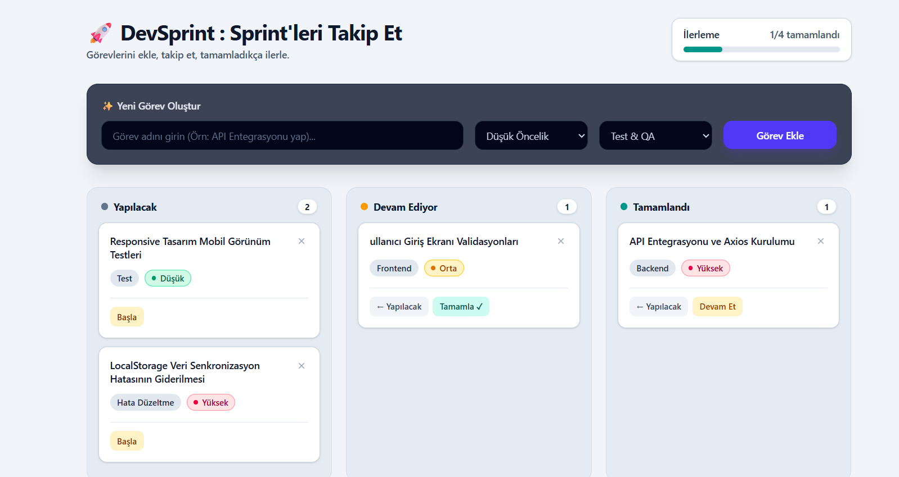

# 🚀 DevSprint - Görev ve Sprint Yönetim Panosu

> **🎓 Software Persona Web Geliştirme Eğitimi Bitirme Projesi**
> Bu proje, Software Persona programı kapsamında ReactJS, Tailwind CSS ve Git-Flow prensipleri kullanılarak geliştirilmiş bitirme projesidir.

🔗 **Canlı Demo:** [devsprintboard.netlify.app](https://devsprintboard.netlify.app/)

---

## 📌 Proje Özellikleri

- **Tam CRUD Operasyonları:**
  - ➕ **Create (Ekle):** Görev başlığı, öncelik seviyesi ve kategori seçimi ile yeni görev oluşturma.
  - 📋 **Read (Listele):** Görevleri "Yapılacak", "Devam Ediyor" ve "Tamamlandı" kolonlarına göre dinamik listeleme.
  - ⚡ **Update (Güncelle):** Görev durumunu (kolonlar arası) tek tıkla ve **onay mekanizması (`window.confirm`)** ile taşıma.
  - 🗑️ **Delete (Sil):** Görevleri güvenli silme onay adımıyla listeden kaldırma.
- **Kalıcı Veri Depolama (LocalStorage):** Özel `useLocalStorage` hook'u sayesinde eklenen görevler ve ilerleme verisi tarayıcı hafızasında saklanır.
- **Dinamik İlerleme Çubuğu:** Tamamlanan görev oranına göre anlık güncellenen görsel ilerleme göstergesi.
- **Modern & Yüksek Kontrast Tasarım:** Tailwind CSS ile oluşturulmuş, okunabilirliği yüksek renk paletleri ve kart mimarisi.
- **Responsive Yapı:** Mobilde alt alta, tablet ve masaüstünde üç kolon yan yana görünüm.
- **Git-Flow Disiplini:** `main`, `develop` ve özellik bazlı (`feature/task-create`) branch yönetimi.

---

## 📸 Ekran Görüntüleri



### 🖥️ Ana Sayfa ve Pano Görünümü


<!-- Kendi ekran görüntünüzün yolunu ekleyebilirsiniz -->

---

## 🛠️ Kullanılan Teknolojiler

- **Frontend:** ReactJS, Vite
- **Styling:** Tailwind CSS (v4)
- **State Management & Custom Hooks:** React Hooks (`useState`, `useEffect`), Custom `useLocalStorage` Hook
- **Deployment:** Netlify
- **Version Control:** Git, GitHub (Git-Flow)

---

## 📁 Klasör Mimarisi

```text
dev-sprint-board/
├── src/
│   ├── components/
│   │   └── TaskForm.jsx        # Modüler görev ekleme formu
│   ├── hooks/
│   │   └── useLocalStorage.js  # LocalStorage veri kalıcılığı hook'u
│   ├── App.jsx                 # Ana pano ve CRUD mantığı
│   ├── index.css               # Tailwind CSS yapılandırması
│   └── main.jsx                # Uygulama giriş noktası
├── public/
├── package.json
└── README.md
```

---

## 🚀 Yerel Kurulum ve Çalıştırma

Projeyi kendi bilgisayarınızda çalıştırmak için aşağıdaki adımları izleyebilirsiniz.

**1. Repoyu klonlayın:**

```bash
git clone https://github.com/zeyneptass/DevSprintBoard.git
cd DevSprintBoard
```

**2. Bağımlılıkları yükleyin:**

```bash
npm install
```

**3. Geliştirme sunucusunu başlatın:**

```bash
npm run dev
```

**4. Tarayıcınızda [http://localhost:5173/](http://localhost:5173/) adresine giderek projeyi görüntüleyin.**

---

## 📄 Lisans

Bu proje Software Persona Web Geliştirme bitirme projesi olarak eğitim ve geliştirme amaçlı hazırlanmıştır.